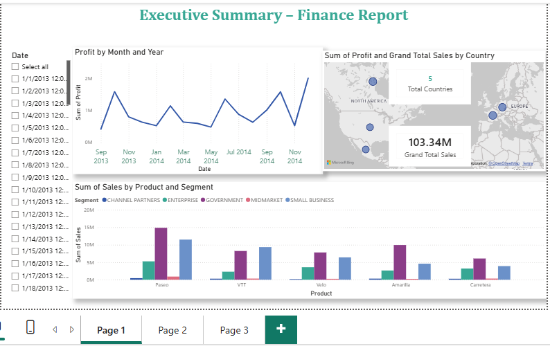
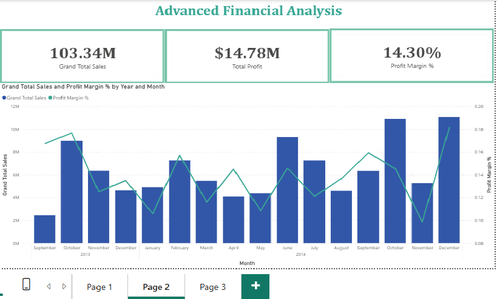
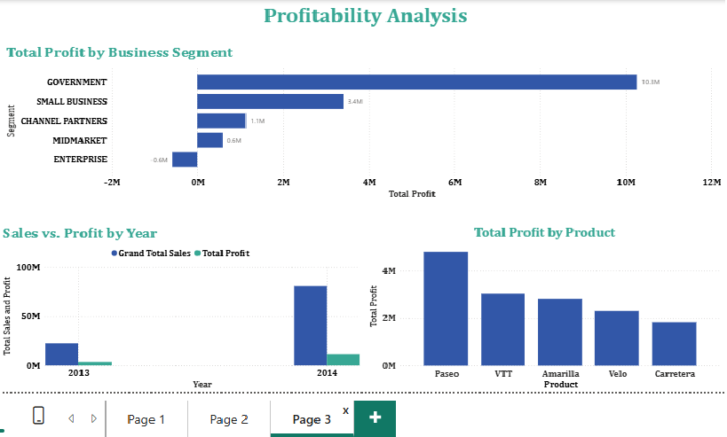

# Power BI Project 1 — Executive Finance Dashboard

## Overview
An interactive executive finance report developed in Microsoft Power BI using Microsoft's Financial Sample dataset.

## Dashboard Features
- Monthly and yearly profit trends
- Sales performance by product and segment
- Geographic analysis by country
- Interactive year and month slicers
- Executive summary indicators

## Tools and Skills
Power BI Desktop, Power Query, data modeling, calendar tables, charts, maps, slicers, and business intelligence reporting.

## Report File
`Financials_Time_Intelligence.pbix`

## Completion Date
April 28, 2026

## Dataset
Microsoft Financial Sample Excel workbook.

## Dashboard Screenshots

### Page 1 — Executive Summary

### Page 2 — Advanced Financial Analysis

### Page 3 — Profitability Analysis

