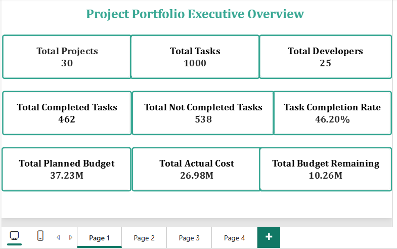

# Projects Performance Analytics — Power BI Portfolio Project

A four-page Power BI portfolio report analyzing project progress, task status, budgets, and costs across a project-management dataset.

## Opening the Power BI Report

1. Download [Projects_Performance_Analytics.pbix](Projects_Performance_Analytics.pbix).
2. Open the file using Microsoft Power BI Desktop.
3. Explore the four report pages and their DAX-powered visualizations.
4. To refresh the data from Excel, update the source workbook connection under **Transform data → Data source settings**.

**Note:** The Power BI report and dashboard screenshots are included in this repository. The original Excel source workbook is not currently provided separately.

## Snapshot

The dashboard screenshots show these portfolio-level metrics:

| Metric | Value |
|---|---:|
| Distinct projects | 30 |
| Task records | 1,000 |
| Developers | 25 |
| Completed task records | 462 |
| Not-completed task records | 538 |
| Task completion rate | 46.20% |
| Total planned budget | $37.23M |
| Total actual cost | $26.98M |
| Budget remaining | $10.26M |

Budget figures are rounded to two decimal places in millions. Exact results depend on source-data refresh and active report filters.

## Report Pages

1. **Project Portfolio Executive Overview** — Nine KPI cards covering project count, task records, completion, developers, and financial totals.
2. **Task Status Distribution** — Donut chart showing Completed, Delayed, Not Started, Cancelled, In Progress, and On Hold task-record counts.
3. **Project Completion Analysis** — Horizontal bar chart of completion percentages across 30 projects, sorted for easy comparison.
4. **Budget & Resource Analysis** — Comparison of planned budgets and actual costs by project. Developer-workload analysis remains a possible enhancement.

## Screenshots

### Executive Overview



### Task Status Distribution


### Project Completion Analysis


### Budget vs. Actual Costs


## Tools and Skills

- Microsoft Power BI Desktop, Power Query, and DAX
- Excel-based project-management data
- DAX measures, `CALCULATE`, `COUNTROWS`, `SUM`, `DIVIDE`, and filter context
- KPI cards, donut charts, clustered bar and column charts
- Data visualization, dashboard formatting, and data-quality validation

## Key DAX Logic

The `Project Completion %` measure divides completed task records by total task records within each project's filter context.

```dax
Project Completion % =
VAR TotalProjectTasks =
    COUNTROWS('Project Management')
VAR CompletedProjectTasks =
    CALCULATE(
        COUNTROWS('Project Management'),
        'Project Management'[Status] = "Completed"
    )
RETURN
    DIVIDE(
        CompletedProjectTasks,
        TotalProjectTasks,
        0
    )
```

**Metric definition:** This is a record-count completion ratio, not an effort-weighted or cost-weighted progress measure. Cancelled task records remain in the denominator, and repeated task names are counted as separate records.

## Data Validation

Project-level financial calculations were verified against Power BI tooltips using DAX measures with project-specific filters.

**Analytics Dashboard — Example**

| Financial Metric | Value |
|---|---:|
| Planned Budget | $1,734,000 |
| Actual Cost | $1,424,100 |
| Remaining Budget | $309,900 |

## Future Enhancement: Scheduled Cloud Refresh

The initial version imports Excel data.

A future enhancement could use **OneDrive for Business or SharePoint Online** as a cloud-hosted data source, connected to Power BI Service.

This could enable:

- Automated retrieval of updated project-management data
- Scheduled semantic-model refresh
- Updated dashboard KPIs and visualizations following successful refresh
- Reduced manual data-upload effort

**Status:** Cloud synchronization is planned and has not yet been implemented.

## Security

Power BI files may contain imported data, query details, and connection metadata. Source files and reports should be reviewed before public distribution. Credentials, tokens, and confidential information must not be committed.

## Project Status

**Completed and published on GitHub.**

The repository includes the Power BI report (`.pbix`), four dashboard screenshots, and project documentation.

Future enhancements may include developer-workload analysis, scheduled cloud refresh, and improved reporting automation.
