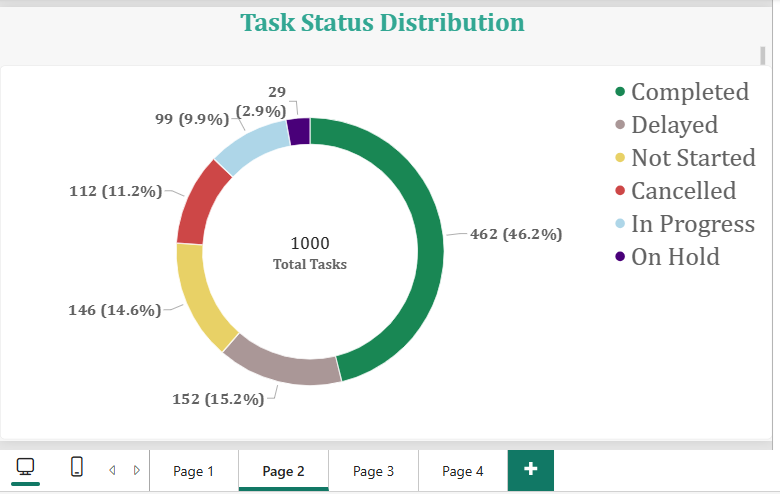
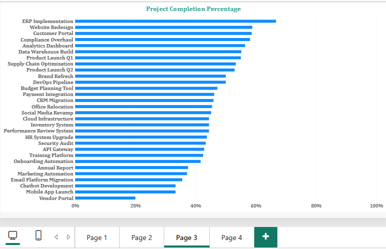
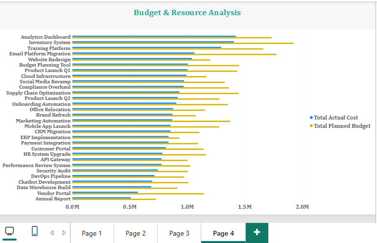

# Projects Performance Analytics — Power BI Portfolio Project

A four-page Power BI portfolio report analyzing project progress, task status, budgets, and costs across a project-management dataset.

## Snapshot

The dashboard screenshots show these portfolio-level metrics:

| Metric | Value |
|---|---:|
| Distinct projects | 30 |
| Task records | 1,000 |
| Developers | 25 |
| Completed task records | 462 |
| Not-completed task records | 538 |
| Task completion rate | 46.20% |
| Total planned budget | $37.23M |
| Total actual cost | $26.98M |
| Budget remaining | $10.26M |

Budget figures are rounded to two decimal places in millions in the report. The exact results depend on source-data refresh and active report filters.

## Report pages

1. **Project Portfolio Executive Overview** — nine KPI cards covering project count, task records, completion, developers, and financial totals.
2. **Task Status Distribution** — donut chart showing Completed, Delayed, Not Started, Cancelled, In Progress, and On Hold task-record counts.
3. **Project Completion Analysis** — horizontal bar chart of completion percentages across 30 projects, sorted for easy comparison.
4. **Budget & Resource Analysis** — comparison of planned budget and actual costs by project. (The current screenshots show a budget comparison; developer-workload analysis remains a possible enhancement.)

## Screenshots

### Executive overview

### Task status distribution

### Project completion analysis

### Budget vs. actual costs

## Tools and skills

- Power BI Desktop; Power Query; DAX
- Excel project-management data
- Measures, `CALCULATE`, `COUNTROWS`, `SUM`, `DIVIDE`, and filter context
- Clustered bar/column charts, KPI cards, donut charts, formatting and data-quality validation

## Key DAX logic

`Project Completion %` divides completed task records in each project's filter context by all task records in that same context. See [DAX measures](docs/DAX_Measures.md) for the implemented formula and budget-verification measures.

> **Metric definition:** This is a *record-count completion ratio*, not an effort-weighted or cost-weighted progress measure. Cancelled task records remain in the denominator. Repeated task names are treated as separate records.

## Opening the report

1. Open the `.pbix` file in Power BI Desktop (once added under `powerbi/`).
2. Review **Transform data → Data source settings** and update the Excel source path if the workbook is located elsewhere.
3. If a sample workbook is included under `data/`, confirm that only non-sensitive, shareable information is present.
4. Click **Refresh** and review the calculated KPI totals and visuals.

**Note:** This starter upload package contains documentation and screenshots, but does *not* contain the `.pbix` or Excel workbook. Add those separately from the local PC before claiming the repository is a runnable Power BI deliverable.

## Future enhancement: scheduled cloud refresh

The initial version imports Excel data. A future iteration could store a suitable workbook in OneDrive for Business or SharePoint Online, connect through an appropriately configured Power BI data source, publish the semantic model, and enable scheduled refresh. This is *planned*, not implemented in this repository. Details: [refresh roadmap](docs/Refresh_Roadmap.md).

## Validation and security

- Cross-check project-specific measures against project-level source records and tooltip values.
- Example project validation in the report: **Analytics Dashboard** has a planned budget of **$1,734,000** and actual costs of **$1,424,100**, leaving **$309,900**.
- Review the workbook and PBIX before public upload. Power BI files may contain imported data, query details, or connection metadata. Never commit passwords, tokens, credentials, or confidential source data.

## Status

Report designed and visually reviewed; external repository publication, `.pbix` addition, reproducibility checks, and automatic refresh setup are separate steps.
