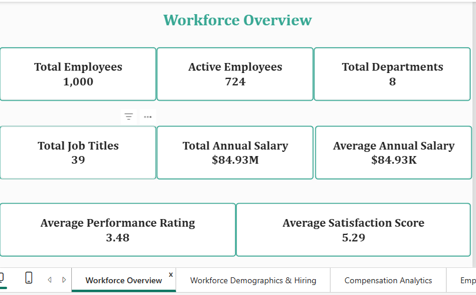
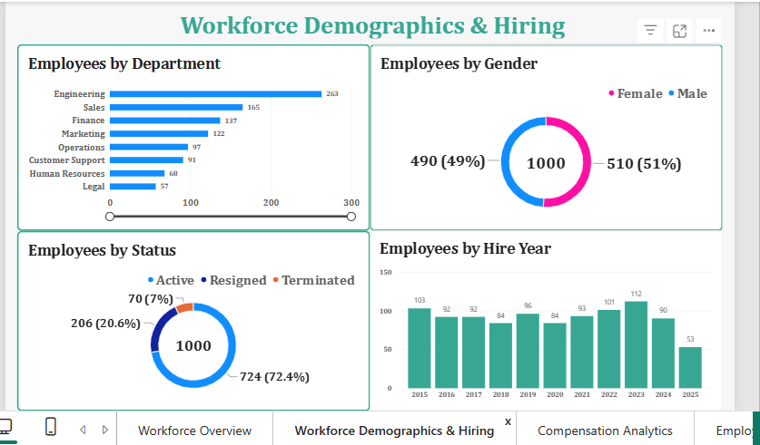
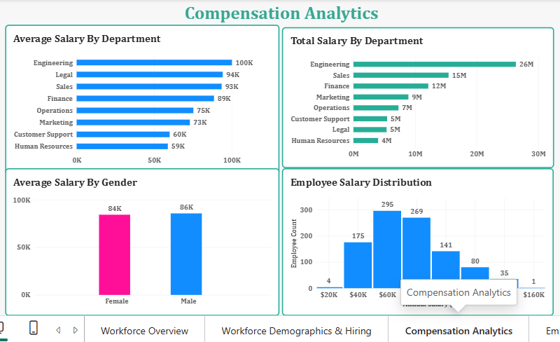
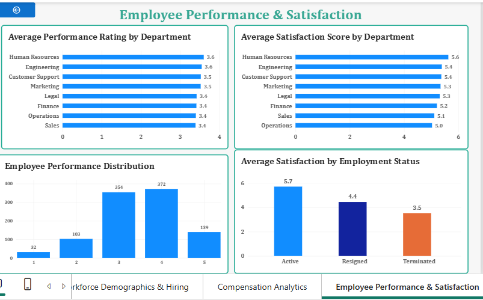

# HR Employment Analysis — Power BI Portfolio Project

A four-page interactive Power BI report analyzing workforce demographics, hiring patterns, employee compensation, performance ratings, and job satisfaction.

## Opening the Power BI Report

1. Download [HR_Employment_Analysis.pbix](HR_Employment_Analysis.pbix).
2. Open the file using Microsoft Power BI Desktop.
3. Explore the four interactive report pages and their DAX-powered visualizations.
4. To refresh the data from Excel, update the source workbook connection under **Transform data → Data source settings**.

## Data Source

- Source: [TrumpExcel — Employee HR Records Dataset](https://trumpexcel.com/excel-sample-data/)
- File format: Microsoft Excel
- Employee records: 1,000
- Attributes: 10
- Calendar coverage: 2015–2025

The dataset contains synthetic employee records intended for educational and analytical purposes. It does not represent actual company employees.

## Workforce Snapshot

| Metric | Value |
|---|---:|
| Total Employees | 1,000 |
| Active Employees | 724 |
| Resigned Employees | 206 |
| Terminated Employees | 70 |
| Total Departments | 8 |
| Total Job Titles | 39 |
| Female Employees | 510 |
| Male Employees | 490 |
| Total Annual Salary | $84.93M |
| Average Annual Salary | $84.93K |
| Average Performance Rating | 3.48 |
| Average Satisfaction Score | 5.29 |

## Report Pages

### 1. Workforce Overview

An executive-level overview featuring eight KPI cards covering workforce size, employment, organizational structure, compensation, performance, and satisfaction.

### 2. Workforce Demographics & Hiring

- Employees by department
- Employees by gender
- Employees by employment status
- Employees by hire year from 2015 through 2025

### 3. Compensation Analytics

- Average annual salary by department
- Total annual salary by department
- Average annual salary by gender
- Employee salary distribution using $20,000 numerical bins

### 4. Employee Performance & Satisfaction

- Average performance rating by department
- Average satisfaction score by department
- Employee performance rating distribution
- Average satisfaction by employment status

## Data Modeling

The data model consists of two tables:

- **Employee HR Records:** Primary employee information and analytical attributes.
- **Calendar:** Date dimension covering January 1, 2015, through December 31, 2025.

A one-to-many relationship connects Calendar[Date] to Employee HR Records[Hire Date], with single-direction filtering from Calendar to Employee HR Records.

## Tools and Technical Skills

- Microsoft Power BI Desktop
- Microsoft Excel
- Power Query and M language
- Data type management
- Relational data modeling
- Calendar dimension development
- DAX measures and iterator functions
- Dynamic axis calculations
- Numerical binning and histogram visualization
- Continuous and categorical axes
- KPI cards, donut charts, bar charts, and column charts
- Interactive cross-filtering and cross-highlighting
- Data validation and visual storytelling

## Key Analytical Findings

- Engineering is the largest department, with 263 employees representing 26.3% of the dataset.
- The workforce has a nearly balanced gender distribution: 51% female and 49% male.
- Active employees represent 72.4% of all employee records.
- Engineering has the highest average and total annual salary.
- Approximately 56.4% of employees earn between $60,000 and under $100,000 annually.
- 51.1% of employees received performance ratings of 4 or 5.
- Active employees have a higher average satisfaction score (5.7) than resigned employees (4.4) and terminated employees (3.5).

## Data Validation

Employee counts displayed across the following analytical dimensions reconcile to 1,000 records:

- Department
- Gender
- Employment status
- Hiring year
- Salary distribution
- Performance rating distribution

The weighted average calculated from the performance rating distribution is 3.483, consistent with the dashboard KPI of 3.48.

## Analytical Limitations

- The dataset is synthetic and should not be interpreted as evidence about an actual organization.
- Total annual salary includes all employment statuses and does not represent current payroll expenditure.
- Hiring-year counts represent employees recorded in the dataset, not historical workforce headcount.
- Historical turnover rates cannot be accurately calculated without employee departure dates.
- Gender compensation comparisons are unadjusted for job title, department, seniority, and other potential explanatory variables.
- Associations between satisfaction and employment status do not establish causation.

## Future Enhancements

- Develop a corresponding Tableau report using the same dataset.
- Extend HR analytics using the IBM Employee Attrition & Performance dataset.
- Explore employee attrition prediction using Python and machine learning.
- Implement cloud-based data sources and scheduled refresh.

## Project Status

Power BI report development completed — November 25, 2026.
