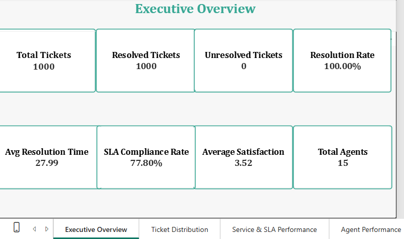

# Support Tickets Data Analysis — Power BI Portfolio Project

A four-page interactive Microsoft Power BI report analyzing customer support ticket distribution, resolution efficiency, Service Level Agreement (SLA) compliance, customer satisfaction, and agent performance.

## Opening the Power BI Report

1. Download [Support Tickets Data Analysis.pbix](Support%20Tickets%20Data%20Analysis.pbix).
2. Open the file using Microsoft Power BI Desktop.
3. Explore the four interactive report pages and their DAX-powered visualizations.
4. To refresh the data from Excel, update the source workbook connection under **Transform data → Data source settings**.

## Dataset Overview

- Data source format: Microsoft Excel
- Support ticket records: 1,000
- Support agents: 15
- Issue categories: 5
- Priority levels: 4
- Communication channels: 4
- Ticket creation period: January 2024–December 2025
- Calendar dimension: January 1, 2024–January 31, 2026

### Dataset Attributes

| Column | Data Type |
|---|---|
| Ticket ID | Text |
| Created Date | Date |
| Resolved Date | Date |
| Channel | Text |
| Issue Category | Text |
| Priority | Text |
| Assigned Agent | Text |
| Resolution Time (Hours) | Decimal Number |
| SLA Met | Text |
| Customer Satisfaction | Whole Number |

## Executive Performance Snapshot

| Metric | Value |
|---|---:|
| Total Tickets | 1,000 |
| Resolved Tickets | 1,000 |
| Unresolved Tickets | 0 |
| Resolution Rate | 100.00% |
| Average Resolution Time | 27.99 hours |
| SLA Met Tickets | 778 |
| SLA Breached Tickets | 222 |
| SLA Compliance Rate | 77.80% |
| Average Customer Satisfaction | 3.52 |
| Total Agents | 15 |

## Report Pages

### Page 1 — Executive Overview

An executive-level dashboard featuring eight KPI cards summarizing overall customer support operations, resolution efficiency, SLA compliance, and customer satisfaction.



### Page 2 — Ticket Distribution

- Tickets by issue category
- Tickets by priority
- Tickets by communication channel
- Monthly ticket volume across 2024 and 2025


### Page 3 — Service & SLA Performance

- SLA compliance distribution
- Average resolution time by priority
- SLA compliance rate by issue category
- Monthly SLA compliance rate


### Page 4 — Agent Performance

- Ticket volume by assigned agent
- Average resolution time by agent
- SLA compliance rate by agent
- Average customer satisfaction by agent

Interactive scrolling enables users to examine all 15 support agents.


## Data Modeling

The semantic model consists of two tables:

- **Support Tickets:** Primary transactional table containing customer support ticket information.
- **Calendar:** Date dimension supporting chronological and time-based analysis.

### Table Relationships

| Relationship | Cardinality | Filter Direction | Status |
|---|---|---|---|
| Calendar[Date] → Support Tickets[Created Date] | One-to-many | Single | Active |
| Calendar[Date] → Support Tickets[Resolved Date] | One-to-many | Single | Inactive |

The active relationship supports ticket creation analysis. The inactive relationship enables future resolution-date analysis through the DAX `USERELATIONSHIP()` function.

## Key DAX Measures

**Total Tickets**

```dax
Total Tickets =
DISTINCTCOUNT('Support Tickets'[Ticket ID])
```

**Unresolved Tickets**

```dax
Unresolved Tickets =
COALESCE(
    CALCULATE(
        [Total Tickets],
        ISBLANK('Support Tickets'[Resolved Date])
    ),
    0
)
```

**Average Resolution Time**

```dax
Avg Resolution Time =
AVERAGE('Support Tickets'[Resolution Time (Hours)])
```

**SLA Met Tickets**

```dax
SLA Met Tickets =
CALCULATE(
    DISTINCTCOUNT('Support Tickets'[Ticket ID]),
    'Support Tickets'[SLA Met] = "Yes"
)
```

**SLA Breached Tickets**

```dax
SLA Breached Tickets =
CALCULATE(
    DISTINCTCOUNT('Support Tickets'[Ticket ID]),
    'Support Tickets'[SLA Met] = "No"
)
```

**SLA Compliance Rate**

```dax
SLA Compliance Rate =

