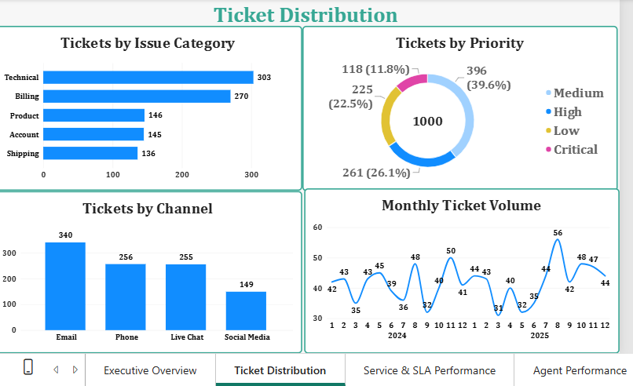
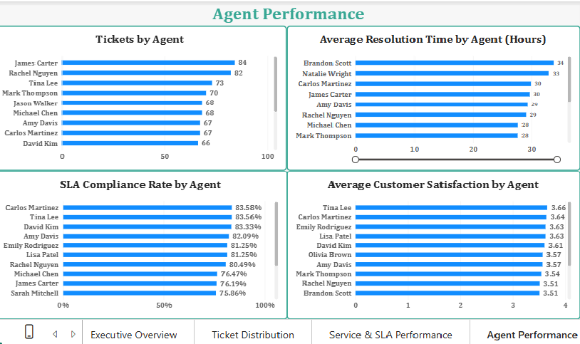

# Support Tickets Data Analysis — Power BI Portfolio Project

A four-page interactive Microsoft Power BI report analyzing customer support ticket distribution, resolution efficiency, Service Level Agreement (SLA) compliance, customer satisfaction, and agent performance.

## Opening the Power BI Report

1. Download [Support Tickets Data Analysis.pbix](Support%20Tickets%20Data%20Analysis.pbix).
2. Open the file using Microsoft Power BI Desktop.
3. Explore the four interactive report pages and their DAX-powered visualizations.
4. To refresh the data from Excel, update the source workbook connection under **Transform data → Data source settings**.

## Dataset Overview

- Data source format: Microsoft Excel
- Support ticket records: 1,000
- Support agents: 15
- Issue categories: 5
- Priority levels: 4
- Communication channels: 4
- Ticket creation period: January 2024–December 2025
- Calendar dimension: January 1, 2024–January 31, 2026

### Dataset Attributes

| Column | Data Type |
|---|---|
| Ticket ID | Text |
| Created Date | Date |
| Resolved Date | Date |
| Channel | Text |
| Issue Category | Text |
| Priority | Text |
| Assigned Agent | Text |
| Resolution Time (Hours) | Decimal Number |
| SLA Met | Text |
| Customer Satisfaction | Whole Number |

## Executive Performance Snapshot

| Metric | Value |
|---|---:|
| Total Tickets | 1,000 |
| Resolved Tickets | 1,000 |
| Unresolved Tickets | 0 |
| Resolution Rate | 100.00% |
| Average Resolution Time | 27.99 hours |
| SLA Met Tickets | 778 |
| SLA Breached Tickets | 222 |
| SLA Compliance Rate | 77.80% |
| Average Customer Satisfaction | 3.52 |
| Total Agents | 15 |

## Report Pages

### Page 1 — Executive Overview

An executive-level dashboard featuring eight KPI cards summarizing overall customer support operations, resolution efficiency, SLA compliance, and customer satisfaction.


### Page 2 — Ticket Distribution

- Tickets by issue category
- Tickets by priority
- Tickets by communication channel
- Monthly ticket volume across 2024 and 2025



### Page 3 — Service & SLA Performance

- SLA compliance distribution
- Average resolution time by priority
- SLA compliance rate by issue category
- Monthly SLA compliance rate


### Page 4 — Agent Performance

- Ticket volume by assigned agent
- Average resolution time by agent
- SLA compliance rate by agent
- Average customer satisfaction by agent

Interactive scrolling enables users to examine all 15 support agents.



## Data Modeling

The semantic model consists of two tables:

- **Support Tickets:** Primary transactional table containing customer support ticket information.
- **Calendar:** Date dimension supporting chronological and time-based analysis.

### Table Relationships

| Relationship | Cardinality | Filter Direction | Status |
|---|---|---|---|
| Calendar[Date] → Support Tickets[Created Date] | One-to-many | Single | Active |
| Calendar[Date] → Support Tickets[Resolved Date] | One-to-many | Single | Inactive |

The active relationship supports ticket creation analysis. The inactive relationship enables future resolution-date analysis through the DAX `USERELATIONSHIP()` function.

## Key DAX Measures

**Total Tickets**

```dax
Total Tickets =
DISTINCTCOUNT('Support Tickets'[Ticket ID])
```

**Unresolved Tickets**

```dax
Unresolved Tickets =
COALESCE(
    CALCULATE(
        [Total Tickets],
        ISBLANK('Support Tickets'[Resolved Date])
    ),
    0
)
```

**Average Resolution Time**

```dax
Avg Resolution Time =
AVERAGE('Support Tickets'[Resolution Time (Hours)])
```

**SLA Met Tickets**

```dax
SLA Met Tickets =
CALCULATE(
    DISTINCTCOUNT('Support Tickets'[Ticket ID]),
    'Support Tickets'[SLA Met] = "Yes"
)
```

**SLA Breached Tickets**

```dax
SLA Breached Tickets =
CALCULATE(
    DISTINCTCOUNT('Support Tickets'[Ticket ID]),
    'Support Tickets'[SLA Met] = "No"
)
```

**SLA Compliance Rate**

```dax
SLA Compliance Rate =
DIVIDE(
    [SLA Met Tickets],
    [SLA Met Tickets] + [SLA Breached Tickets]
)
```

**Average Customer Satisfaction**

```dax
Average Satisfaction =
AVERAGE('Support Tickets'[Customer Satisfaction])
```

## Key Analytical Findings

### Ticket Distribution

| Issue Category | Tickets | Percentage |
|---|---:|---:|
| Technical | 303 | 30.3% |
| Billing | 270 | 27.0% |
| Product | 146 | 14.6% |
| Account | 145 | 14.5% |
| Shipping | 136 | 13.6% |
| **Total** | **1,000** | **100.0%** |

- Technical and Billing issues account for 57.3% of all support tickets.
- Medium-priority tickets represent the largest priority group at 39.6%.
- High and Critical priority tickets collectively represent 37.9% of all tickets.
- Email is the most frequently used communication channel, accounting for 34.0% of ticket submissions.

### Service & SLA Performance

| Issue Category | SLA Compliance Rate |
|---|---:|
| Account | 81.38% |
| Technical | 78.55% |
| Shipping | 77.21% |
| Billing | 77.04% |
| Product | 74.66% |
| **Overall** | **77.80%** |

- Although all 1,000 tickets were resolved, 222 tickets breached their SLA requirements.
- Account issues achieved the highest SLA compliance rate.
- Product issues achieved the lowest SLA compliance rate, indicating a potential opportunity for service improvement.
- Higher-priority tickets generally have shorter average resolution times.

### Agent Performance

The report enables comparative analysis of 15 support agents across four operational dimensions:

- Ticket workload
- Resolution efficiency
- SLA compliance
- Customer satisfaction

Agent-level performance comparisons should consider differences in ticket priority, issue complexity, and workload.

## Technical Challenge and Resolution

During report development, a DAX data type conversion error occurred when calculating monthly SLA compliance rates.

The root cause was the use of `FORMAT()` in the Total Tickets measure, which converted numeric results into text. Under certain filter contexts, empty strings caused subsequent numeric calculations to fail.

The issue was addressed by:

- Maintaining numeric results in analytical measures.
- Removing unnecessary `FORMAT()` calls from numeric calculations.
- Using Power BI Measure tools and visual formatting for presentation.
- Using `COALESCE()` where a numeric zero is appropriate.
- Using `DIVIDE()` to safely handle zero denominators.

This experience reinforced an important BI development principle:

**Separate calculation logic from presentation formatting.**

## Data Validation

- Issue category counts reconcile to 1,000 tickets.
- Priority counts reconcile to 1,000 tickets.
- Communication channel counts reconcile to 1,000 tickets.
- Resolved and unresolved ticket counts reconcile to the total ticket count.
- SLA Met and SLA Breached counts reconcile to 1,000 evaluated tickets.
- Monthly reporting uses chronological year and month-number sorting.

## Tools and Technical Skills

- Microsoft Power BI Desktop
- Microsoft Excel
- Power Query and M language
- Data extraction, transformation, and loading (ETL)
- Data type management
- Relational data modeling
- Calendar dimension development
- Active and inactive relationships
- DAX measures and filter context
- DAX measure dependencies
- Numeric data type debugging
- KPI development
- IT Service Management analytics
- SLA compliance analysis
- Interactive dashboard development
- Data validation and analytical storytelling

## Analytical Limitations

- The report represents the supplied dataset and should not be generalized to other support organizations without validation.
- Specific SLA thresholds have not been independently verified.
- Agent comparisons are not adjusted for ticket complexity or priority.
- Ticket creation volumes do not necessarily represent ticket resolution volumes within the same reporting period.
- Associations between operational metrics do not establish causation.
- The original Excel workbook may be required to refresh the report.

## Future Enhancements

- Develop a corresponding Tableau dashboard using the same dataset.
- Integrate support ticket data with SQL Server.
- Implement automated cloud-based data refresh.
- Develop additional resolution-date and backlog analyses.
- Explore predictive analytics for identifying potential SLA breaches using Python and machine learning.
- Explore AI-powered customer support analytics and intelligent ticket classification.

## Project Status

**Power BI report development completed — November 27, 2026.**

Project 4 of my professional Power BI analytics portfolio.

**Practice makes perfect. Continuous learning leads to professional excellence.**

*Übung macht den Meister!*
